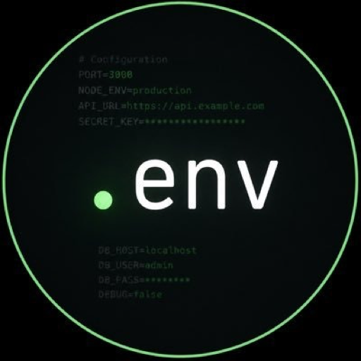

# .env — Blocknet (BNT) macOS Miner

<p align="center">
  
  <br />
  <strong>High-performance native Apple Silicon CPU miner & real-time telemetry dashboard for Blocknet (BNT) on bntpool.com.</strong>
  <br /><br />
  <a href="https://github.com/lemo1bot/dotenv-miner/releases/latest/download/DotEnv-1.0.0.dmg">
    
  </a>
  <a href="https://github.com/lemo1bot/dotenv-miner/releases">
    
  </a>
  <a href="https://bntpool.com/">
    
  </a>
</p>

---

## ⚡ Overview

**.env** is a standalone, native macOS application designed specifically for mining **Blocknet (BNT)** on [bntpool.com](https://bntpool.com/). Built in native Swift/SwiftUI with a bundled Apple Silicon ARM64 Argon2id engine (`seine`), it provides a zero-setup, 1-click mining experience with 100% verified real-time telemetry and balance reporting.

---

## 🚀 Key Features

### 1. ⚡ Native Apple Silicon Mining Engine
- **Bundled `seine` Engine**: Embedded ARM64 Argon2id miner (`seine` v0.2.15) optimized for Apple Silicon (M1/M2/M3/M4/Pro/Max).
- **Argon2id Memory Protection**: Dynamically detects available system RAM and clamps thread allocations (~2 GB per Argon2id lane) to guarantee system stability and prevent out-of-memory panics.
- **Zero Dependencies**: Completely standalone — no Homebrew, Python, or command-line setup required.

### 2. 📊 Real-Time Hardware Telemetry (No Fakes)
- **Live Hashrate Sparkline**: Streams actual `INFO STATS rate=X.XX H/s` directly from the engine's stdout.
- **Stratum Job Status**: Live tracking of stratum block height, difficulty targets, accepted shares, rejected shares, and submission latency.
- **Accurate Hardware Performance**: Computes real Argon2id PoW hashes on macOS.

### 3. 💰 Live Real-Time Earnings from [bntpool.com](https://bntpool.com/)
- **Confirmed & Immature Balance**: Real-time polling of `https://bntpool.com/api/miner/<address>/balance?include_pending_estimate=true`.
- **Payout Progress**: Live progress indicator tracking confirmed balance towards the pool's **0.10 BNT** minimum payout threshold.
- **Global Network & Pool Metrics**: Live network hashrate and pool hashrate monitoring from `bntpool.com/api/stats` to calculate accurate projected earnings per hour, day, and month.

### 4. 🔑 Automatic blocknet.app Wallet Detection
- **Auto-Sync**: Automatically detects existing wallet backup files from official `blocknet.app` desktop wallets in `~/Library/Application Support/blocknet/mainnet/`.
- **Import Button**: Easily import or refresh your wallet address with a single click.

### 5. ⚙️ Transparent 1% Developer Fee
- Fully disclosed and transparent 1% developer fee (36 seconds per hour mines to the developer address, 99% mines directly to your wallet).
- If you are mining to the developer address, the app detects your wallet and runs 100% full-time with zero interruptions.

---

## 📦 Installation

1. Download [**`DotEnv-1.0.0.dmg`**](https://github.com/lemo1bot/dotenv-miner/releases/latest/download/DotEnv-1.0.0.dmg).
2. Open the `.dmg` file and drag **`.env`** (`DotEnv.app`) into your **Applications** folder.
3. Launch **`.env`** from Applications or Spotlight.
4. Enter or auto-import your Blocknet wallet address and click **Start Mining**!

---

## 🛠️ Building From Source

```bash
# Clone the repository
git clone https://github.com/lemo1bot/dotenv-miner.git
cd dotenv-miner

# Build and package the DMG
chmod +x build_dmg.sh
./build_dmg.sh
```

The compiled application and DMG will be output to `dist/DotEnv-1.0.0.dmg` and copied to your Desktop.

---

## 📄 License

MIT License.
